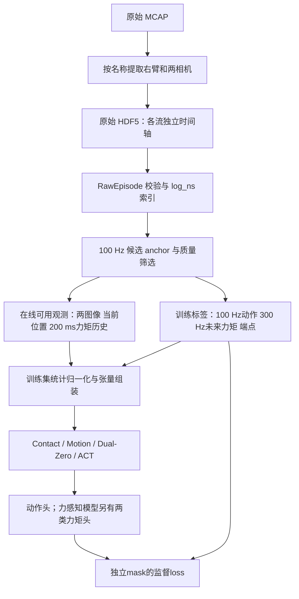
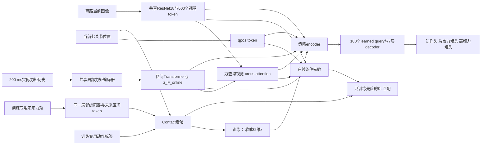

# 真机训练模型架构：右臂多频率视觉—关节扰动力矩 ACT

> 代码核对日期：2026-09-20。本文描述已经实现的真机训练路径，以 `scripts/train_real_robot.py` 为入口；不是待实施方案。默认参数来自 `configs/real_robot/right_arm.json` 和 `real_robot/training.py`。
>
> 适用模型：新版高频 Contact-CVAE、Motion-CVAE、Dual-Zero，以及 Official ACT 网络基线。旧模拟入口中的“500 Hz、六维 wrench、30 Hz policy”默认值不代表本文真机配置。

## 1. 当前模型究竟学习什么

在一个观测时刻 `t`，模型读取两路 RGB 图像、右臂七关节当前位置，以及最近 200 ms 的七维关节扰动力矩历史，预测后续一段七关节**绝对目标位置命令**。

三个力感知模型额外预测未来关节扰动力矩，作为辅助监督；ACT 基线只预测动作。所有模型都不把关节速度作为输入，不增加合成末尾静止段，也没有受训练的任务完成分类头。

| 信号 | 当前语义 | 单位 | 标称频率 | 作用 |
| --- | --- | --- | --- | --- |
| D455、D405 | 两路独立 RGB，相机顺序固定为 `d455, d405` | uint8 像素 | 各30 Hz | 当前视觉输入，640×480 |
| `joint_states.position` | 右臂实测位置，`Joint1_R`～`Joint7_R` | rad | 300 Hz | 当前本体状态输入 |
| `joint_states.velocity` | 右臂实测速度 | rad/s | 300 Hz | 保留、校验，不输入网络 |
| `estimated_joint_disturbance.effort` | 右臂外部关节力矩估计，独立时间轴 | N·m | 300 Hz | 历史输入及未来监督 |
| `joint_states.effort` | 右臂真实内部关节力矩 | N·m | 300 Hz | 原始保存，当前不输入、不监督、不归一化 |
| `joint_cmd.position` | 右臂七关节绝对目标位置 | rad | 100 Hz | 动作监督，不是未来实测位置，也不是增量 |

代码中沿用的 `force_*` 命名，在本真机配置下均指七维外部关节力矩估计。2026-09-28 用户纠正了信号来源；重力／摩擦补偿細节未核实，读取层不额外去偏置、滤波、补偿或坐标变换。外部估计和内部力矩各保留自身原始时间戳。

## 2. 原始记录层与训练视图层

### 2.1 原始 MCAP → HDF5

转换器按关节名称提取右臂，排除混在命令 topic 中的手部命令。保留各路原始消息数量与时间戳，不把不同频率的流强行变成等长数组。

```text
episode.hdf5  [schema = real_robot_right_arm_raw_v2]
├── observations/joint_pos                   [N_state, 7], float64
├── observations/joint_vel                   [N_state, 7], float64
├── observations/joint_internal_torque       [N_state, 7], float64（仅保留）
├── observations/joint_external_torque       [N_disturbance, 7], float64
├── observations/images/d455/rgb             [N_d455, 480, 640, 3], uint8
├── observations/images/d405/rgb             [N_d405, 480, 640, 3], uint8
├── observations/images/<camera>/compressed  原始 JPEG 字节
├── observations/images/<camera>/format      原始压缩格式信息
├── action                                  [N_action, 7], float64
├── actions/source_velocity                 原命令附加字段，不参与当前训练
├── actions/source_effort                    原命令附加字段，不作为扰动力矩
├── timestamps/{state,disturbance,action,d455,d405}/
│   ├── header_ns / log_ns / publish_ns
│   └── sequence、frame_id、原 topic 消息索引等
└── metadata/joint_names、camera_names、topic_inventory_json
```

两种图像存储对应同一批图像：`compressed` 保留 JPEG 原字节；`rgb` 是解码后的 RGB，用 HDF5 无损 LZF 压缩。当前训练直接读取 `rgb`，不重复解码 JPEG。LZF 无损指对已经解码的 RGB 无损，并不使原始 JPEG 编码变成无损。

原始 HDF5 不插值、不补零、不补帧、不删掉长间隔、不校正时间偏移，也不复制末尾状态。`training_ready=False` 表示它仍是异步原始格式；新读取器能够从它构建训练视图，不需要把这个属性改成 True。

### 2.2 训练视图

`RawEpisode` 缓存较小的数值流及整数纳秒时间，按需从 HDF5 读取图像。它检查 schema、关节顺序、独立流长度、数值有限性、所选时间轴严格递增、图像形状和 dtype；显式单位或颜色/layout 元数据若与约定冲突则报错。

数值缺失与坏值的处理不同：采样间隔造成的未知标签可以通过 mask 表达；原始数值中的 NaN/Inf、乱序或重复接收时间当前会使读取失败，要求先审查原因，不会自动修复。

## 3. 时间对齐：以100 Hz动作网格组织样本

### 3.1 时间基准

当前仅使用 MCAP **接收时间 `log_ns`** 构建可用性和固定采样网格。用户尚不能确认所有 header 使用同一同步时钟，因此 `header_ns` 和 `publish_ns` 保留用于诊断，不参与 v2 可用性对齐。

`log_ns` 是录制端可用时间的代理，不等于相机曝光时间、关节估计的物理测量时间，也不能证明与机器人控制进程的实际接收时间完全相同。当前没有自动校正传感器估计延迟或通信延迟。

时间索引和绝对时间计算使用整数纳秒。只有先做相对时间差后，才转换成浮点秒给时间编码，避免把大数 epoch 纳秒直接转换为 float32。

定义动作周期 `Δ = 10 ms`，第一条 action 的接收时间为 `t₀`。v2 对开头2秒的 action `log_ns` 关于10 ms周期取循环均值，得到相对首条消息的相位 `φ`：

```text
t_n = t₀ + φ + n × Δ
```

候选 anchor 从 `t₀ + φ` 到最后一条 action 覆盖的时间，不因某个命令缺失而缩短时间轴。相位只从时间戳估计，逐段记录算法、窗口、相位纳秒、集中度、首尾anchor和匹配结果；v1 首条消息定相仍可通过旧配置恢复。模型的 `policy_sample_rate_hz=100` 在本配置中表示动作区间频率，不表示必须100 Hz调用神经网络。

### 3.2 当前图像与位置：只能向过去查找

对于 anchor `t`，每个观测流独立选取满足 `接收时间 ≤ t` 的最新消息：

| 观测 | 新鲜度条件 | 不满足时 |
| --- | --- | --- |
| 关节位置 | `t − state_time ≤ 20 ms` | 排除该训练anchor；在线报告观测不可用 |
| D455图像 | `t − d455_time ≤ 100 ms` | 同上 |
| D405图像 | `t − d405_time ≤ 100 ms` | 同上 |

两相机不共享帧号，也不保证选中的两张图像拍摄于同一时刻。30 Hz图像供100 Hz动作网格使用时，多个anchor自然会选择同一张仍有效的历史图像；这是读取时复用已知观测，不是向原始数据添加重复帧。

位置同样选择最新已到达状态，不插值到anchor。图像/位置年龄记录在诊断里，当前没有作为独立数值特征送进模型。

### 3.3 动作标签：固定槽位匹配

对长度 `K` 的动作块，第 `k` 个标签对应：

```text
action_target_time[k] = t + k × 10 ms,  k = 0 ... K−1
```

在该目标时刻附近，按时间查找最近真实 action 消息，容差为 ±5 ms；原消息在整段动作网格中至多匹配一个槽。等距时优先较早消息，未匹配位置保留为空，不把后续命令前移。

标签允许在目标时刻两侧匹配，因为它是训练监督；**在线图像、位置、力矩历史仍严格只向过去查找**。目标时间超出原 action 记录首尾时无效，即使边界消息仍在容差内也不向外扩展。

例如 `K=100`：动作目标时刻是 `t, t+10 ms, ..., t+990 ms`，对应100个动作执行步，通常称约1秒动作块。第0步不是 `t+10 ms`。

### 3.4 历史力矩：实际样本＋固定时间区间

选取 `(t−200 ms, t]` 中所有真实力矩消息，按从旧到新的20个区间组织：

```text
I_i = (t−200 ms+i×10 ms, t−200 ms+(i+1)×10 ms], i=0...19
```

每区间最多存8条样本，实际样本按接收时间排列在前，未使用容量放在后。区间内时间编码使用 `样本实际接收时间 − 区间左端`。

300 Hz下通常每区间约3条、200 ms约60条，但**不是固定截取最近60条**。丢采时样本变少，不会向更早时间追溯以凑满60条；抖动时实际条数可变化。容量8是处理不规则到达的上限，超过上限报错，不静默截断。

当前历史完整性条件是：存在可用的近期state，且200 ms窗口至少包含一条有效力矩。**没有额外要求20个区间全部完整，也没有设置最小60条或独立的长缺口拒绝阈值。** 起始不足200 ms的历史可通过mask进入训练。

### 3.5 未来力矩：固定300 Hz监督槽

动作步 `k` 关联三个未来力矩目标：

```text
τ_target_time[k,j] = t + k×10 ms + (j+1)/300 s, j=0,1,2
```

实际整数时间通过相对偏移四舍五入到纳秒得到。用约 ±1.667 ms容差一对一匹配真实disturbance消息，且来源时间必须严格大于anchor `t`。记录范围外无标签。

| 动作步 | action时刻 | 第1力矩槽 | 第2力矩槽 | 第3力矩槽/端点 |
| --- | --- | --- | --- | --- |
| 0 | `t` | `t+3.333 ms` | `t+6.667 ms` | `t+10 ms` |
| 1 | `t+10 ms` | `t+13.333 ms` | `t+16.667 ms` | `t+20 ms` |
| 99 | `t+990 ms` | `t+993.333 ms` | `t+996.667 ms` | `t+1000 ms` |

所以默认动作标签截止 `t+990 ms`，对应力矩响应标签可到 `t+1000 ms`。匹配是对抖动的有限容差近似，不是插值；来源与目标时间残差可追踪。未来力矩的编码时间使用固定槽位时间，历史力矩使用真实相对时间。

为复用同一个局部编码器，未来力矩内部仍分配8槽，但只有前三槽具有目标含义，其余五槽始终mask。缺少第2槽时保留 `[有效, 缺失, 有效]`，第3槽不能移动到第2槽。

端点标签严格取第3槽。区间内第1或第2槽有数据，不代表端点标签有效。

### 3.6 可训练anchor筛选

当步action有匹配、位置和两图像都可用且不过旧、历史力矩不全空时，anchor才进入Dataset。排除原因按代码检查顺序记录，每个被排除anchor只归入第一个命中的原因。

ACT也使用这组anchor，便于与力感知模型比较；虽然基线数据准备共用质量筛选，**ACT网络及损失不读取力矩张量**。未来action或力矩的局部缺失不要求整块删除，分别通过mask参与训练。

## 4. 缺失、占位值和mask

所有 `*_padding_mask` 都遵循 **True=忽略，False=有效**。

| 情况 | 处理方式 | 是否形成监督 |
| --- | --- | --- |
| 图像/位置还没收到或过旧 | 训练anchor排除；在线报不可用 | 否，不用黑图或零位置替代 |
| action中间无匹配消息 | 保留原时间槽，归一化张量置0，action mask=True | 否，不前值保持 |
| 历史力矩区间不满8槽 | 真实样本与实际时间保留，余槽置0并mask | 只编码真实样本 |
| 历史某个区间全空 | sample mask全True，interval mask=True | 聚合时忽略该区间 |
| 未来力矩中间槽缺失 | 原位置置0并mask，后面的槽不移动 | 仅其他有效槽监督 |
| 未来力矩端点缺失 | 独立endpoint mask=True | 端点loss忽略；区间其他槽仍可监督 |
| episode结束后的未知标签 | 置0并mask，不延长原记录 | 否 |
| 原始NaN/Inf或不合法时间 | 当前读取器直接报错 | 不自动转成可训练数据 |

占位零是在**标准化空间**内放置的占位值，不表示物理力矩为0 N·m，也不表示关节角为0 rad。反归一化占位零会得到均值，因此任何读取标签的模块都必须同时使用mask。

缺失力矩有三层有效性：样本槽mask、区间mask、端点mask。区间mask等于该区间所有样本槽mask的逻辑AND；端点mask只由第3槽决定，与“区间是否至少有一个样本”不同。action mask独立于这些力矩mask。

编码器在投影和时间编码前清除被mask的载荷；后验在投影前清除被mask的action，损失在有效元素上计算，避免 `NaN × 0` 继续传播。局部力矩编码器支持内部空洞，最后值池化取真正最后一个有效槽，而不是用“有效数量−1”猜索引。

## 5. 归一化与模型输入张量

### 5.1 数值标准化

仅用训练split中的原生数据流计算每个关节的均值、标准差：

```text
qpos：每条原生state中的位置统计一次
action：每条原生命令统计一次
torque：每条原生disturbance消息中的外部力矩估计统计一次（内部state.effort不参与）
x_norm[d] = (x[d] − mean[d]) / max(std[d], 0.01)
```

三个统计互相独立，位置与命令不共用均值/标准差。没有按重叠训练窗口重复计数，也不纳入mask占位值。统计覆盖训练记录的完整原生流，包括未被训练网格选中的真实消息；qpos统计不是anchor分布加权统计。

HDF5数值保持float64；组装网络张量时转换为float32。默认训练没有启用AMP混合精度。

### 5.2 图像预处理

RGB uint8先转CHW float32并除以255。默认原图和模型都为480×640，因此不缩放；尺寸确需调整时才使用双线性、`align_corners=False`、抗锯齿resize。当前没有随机裁剪、颜色扰动或其他数据增强。

正式默认使用ImageNet预训练和其归一化：均值 `(0.485,0.456,0.406)`，标准差 `(0.229,0.224,0.225)`。高频模型在读取层做归一化，Official ACT在模型内部做，不能重复执行。`--no-pretrained`或compact检查同时关闭这组ImageNet归一化。

### 5.3 默认batch形状

令 `B`=batch size，`K=100`，`H=20`，容量 `S=8`，关节数 `J=7`：

| 字段 | 形状 | 含义 |
| --- | --- | --- |
| `images` | `[B,2,3,480,640]` | anchor对应的两路图像，无图像历史序列 |
| `qpos` | `[B,7]` | anchor对应当前位置，无qvel |
| `action_chunk` / `action_padding_mask` | `[B,100,7]` / `[B,100]` | 固定100 Hz动作标签 |
| `online_force_intervals` | `[B,20,8,7]` | 最近200 ms真实力矩 |
| `online_force_relative_time` / sample mask | `[B,20,8]` | 区间内实际相对秒及有效性 |
| `online_force_interval_padding_mask` | `[B,20]` | 全空历史区间 |
| `future_force_intervals` | `[B,100,8,7]` | 前3槽有固定300 Hz语义，后5槽恒mask |
| `future_force_relative_time` / sample mask | `[B,100,8]` | 固定槽位相对秒及有效性 |
| `future_force_interval_padding_mask` | `[B,100]` | 全空未来区间 |
| `future_force_target` / endpoint mask | `[B,100,7]` / `[B,100]` | 第3槽端点目标及独立有效性 |

## 6. 整体数据流



训练时某些模型的后验可以读取未来标签；部署入口没有未来action/torque参数。未来力矩是辅助学习目标，当前没有把预测力矩再转换成额外的力控制命令。

## 7. 高频模型的编码架构

### 7.1 正式规模

| 配置 | 真机正式默认 |
| --- | --- |
| `d_model` / attention heads | 512 / 8 |
| Transformer FFN | 3200，ReLU |
| 各Transformer encoder深度 | 4层；历史聚合、后验和策略编码器各自有模块参数 |
| 策略decoder深度 | 7层 |
| dropout / norm | 0.1 / post-norm |
| CVAE潜变量 | 32维 |
| 视觉骨干 | 共享ResNet18，stride=32，FrozenBatchNorm |
| 力矩局部通道 / 残差卷积块 | 128 / 4块 |

FrozenBatchNorm固定的是BN行为，不代表冻结整个ResNet；骨干仍有自己的优化器参数组。

### 7.2 视觉编码

```text
两图像 [B,2,3,480,640]
→ 共享ResNet18（去掉分类头）
→ 每相机特征 [B,512,15,20]
→ 1×1 Conv，投影到 d_model
→ 每相机300个空间token
→ 两相机合计 [B,600,512]
```

位置编码包含二维sin/cos空间位置，以及可学习的相机身份embedding。600个空间token仍进入策略encoder，不是只用一个全局图像向量。视觉token均值 `visual_summary` 另外供Contact条件先验使用。

### 7.3 关节位置编码

标准化后的七关节位置通过 `Linear(7,512)` 变成一个qpos token。当前没有位置历史、显式速度、末端位姿、机器人运动学层或单关节独立token。

### 7.4 高频力矩局部编码：每个10 ms区间一个token

历史20个区间分别使用同一个局部编码器：

```text
[8槽,7关节]
→ Linear(7,128)
→ 加区间内时间sin/cos编码
→ 4个残差时间卷积块
→ masked mean / max / last 三种池化
→ 拼接为384维
→ Linear(384,512) + LayerNorm
→ 一个512维区间token
```

时间编码先用 `relative_time_seconds × 300` 构造坐标，再使用sin/cos频率基底。它接收历史的真实相对时间；不是直接用原始样本行号代替时间。

4个卷积块的dilation分别为1、2、4、8；每块包含两次kernel=3的一维卷积、LayerNorm、ReLU及残差/Dropout，处理过程中持续屏蔽无效槽。这里卷积作用于槽位顺序，时间编码提供实际间隔；它不是连续时间动力学求解器。

三个池化结果都只统计有效样本；全空区间输出零token并由区间mask标记。Contact-CVAE未来力矩也使用**同一个局部编码器、共享权重**，产生训练专用的未来区间token。

### 7.5 跨区间历史编码

```text
20个力矩区间token [B,20,512]
→ 在前面加可学习CLS token
→ 加sin/cos序列位置与CLS/区间类型embedding
→ 4层Transformer encoder，忽略全空区间
→ 取CLS输出 z_F_online [B,512]
```

区间位置从旧到新排列，每个位置对应固定10 ms；缺失区间保留位置并mask，不压紧到一起。因此区间序号具有明确的历史时间含义。

### 7.6 力引导视觉融合

一个8头cross-attention执行：

```text
Q = z_F_online                      一个力矩历史query
K = visual_tokens + visual_position  600个空间key
V = visual_tokens                   600个空间value
输出 z_VF [B,512]
```

它让历史力矩特征从图像空间token中提取相关信息。当前融合模块是这一次cross-attention，没有另加门控或融合MLP；原始视觉token和 `z_F_online` 也都保留给后续策略encoder。

### 7.7 位置与时间编码总表

| 模块 | 编码方式 |
| --- | --- |
| 高频模型视觉 | 二维sin/cos位置＋可学习相机身份 |
| 区间内力矩 | 相对秒×300后的sin/cos时间编码 |
| 历史区间序列 | sin/cos序列位置＋CLS/区间类型embedding |
| Contact/Motion后验 | sin/cos序列位置＋可学习token类型 |
| 高频策略特殊token | 可学习类型位置embedding |
| 动作decoder | 每个动作槽一个可学习query embedding |

时间戳不会作为一个额外的大数输入直接拼到qpos或图像上；动作query的时间含义来自固定100 Hz网格。

## 8. Contact-CVAE：训练后验、在线先验与策略解码



图中策略主路径使用的是训练后验采样。部署时移除未来标签/后验分支，用零潜变量或在线先验均值替代 `z`。

### 8.1 接触后验

第 `k` 个接触步token是：

```text
c_k = LayerNorm(Linear(action_k) + Enc_local(future_torque_interval_k))
```

后验输入序列为 `[CLS, qpos, c_0, ..., c_(K−1)]`，默认102个token。4层Transformer后的CLS输出分别通过两个 `Linear(512,32)` 得到 `μ_q` 和 `log σ²_q`：

```text
z_contact = μ_q + exp(0.5 × log σ²_q) ⊙ ε，ε ~ N(0,I)
```

后验不直接读取图像。它使用当前位置、动作标签和编码后的未来力矩。

后验mask有一项需要明确区分：action缺失时，整个对应接触步token被屏蔽，附着在这个token上的未来力矩也不进入后验；action有效但未来力矩区间全空时，力矩贡献置0，action token仍可参与后验。即使action缺失，该时间区间中有效的未来力矩仍可用于独立的力矩预测loss。

### 8.2 在线条件先验

将四个512维在线特征拼接：

```text
[qpos_feature, z_F_online, z_VF, mean(visual_tokens)]  → 2048维
→ Linear(2048,512) + ReLU + Dropout
→ 两个 Linear(512,32)：μ_p、log σ²_p
```

训练先验时，四个输入特征和用作目标的后验分布都执行stop-gradient。先验匹配loss只更新条件先验，不通过这条loss反向推动共享视觉/力矩编码器或后验。

### 8.3 策略encoder与decoder

潜变量先投影为512维，策略token按以下顺序拼接：

```text
[z_contact_token, qpos_token, z_F_online, z_VF, 600个视觉token]
```

共604个token，经4层策略encoder得到memory。随后100个可学习query与全零初始target通过7层Transformer decoder，一次生成 `[B,100,512]` 隐状态。

这是整块并行预测，不是逐步自回归生成；没有把上一个预测动作作为下一个query的输入。decoder query本身不接收未来测量时间，固定动作/力矩槽位保证其输出位置具有稳定时间含义。

## 9. 三个对照模型如何变化

| 模型 | 在线输入 | 训练潜变量来源 | 部署潜变量 | 策略memory token数 | 输出 |
| --- | --- | --- | --- | --- | --- |
| `contact` | 图像＋qpos＋历史力矩 | qpos＋action＋未来力矩的Contact后验 | 默认zero；可选条件先验均值 | 604 | action＋两类力矩 |
| `motion` | 图像＋qpos＋历史力矩 | qpos＋action的Motion后验 | zero | 604 | action＋两类力矩 |
| `dual-zero` | 图像＋qpos＋历史力矩 | 无后验、无潜变量 | 无 | 603 | action＋两类力矩 |
| `act` | 图像＋qpos | qpos＋action的官方ACT后验 | zero | 602 | action；另保留未监督的is_pad头 |

Motion-CVAE使用 `[CLS,qpos,action序列]` 的102-token后验，输出32维高斯潜变量。未来力矩只用于预测loss，不进入其后验；力矩历史编码和视觉融合仍保留。

Dual-Zero在结构上移除潜变量投影、潜变量token、后验和先验，不是保留一个恒零潜变量模块。策略特殊token只有 `[qpos,z_F_online,z_VF]`。

ACT基线共享一个ResNet18处理两图像，特征在宽度方向拼接后展平成600个视觉token。每相机生成二维位置编码；没有高频模型的独立相机身份embedding。策略输入为 `[z_motion,qpos,visual_tokens]`。其后验也是 `[CLS,qpos,action序列]`，不读取图像或力矩。

因此这些是已实现架构间的对照，不能把它们描述为只有一个开关不同；尤其Official ACT与高频家族还存在视觉token布局及位置编码等结构差异。

## 10. 输出预测头与物理意义

每个动作query对应一个512维decoder隐状态 `h_k`。所有预测头都是线性层，没有额外递归动力学模块。

| 预测头 | 结构 | 内部输出 | 监督含义 |
| --- | --- | --- | --- |
| `action_head` | `Linear(512,7)` | `[B,K,7]` | `t+kΔ`的标准化绝对关节命令 |
| `force_head` | `Linear(512,7)` | `[B,K,7]` | `t+(k+1)Δ`的标准化力矩端点 |
| `high_rate_force_head` | `Linear(512,8×7)` 后reshape | `[B,K,8,7]` | 前3槽对应区间内300 Hz力矩；其余槽无监督 |
| ACT `is_pad_head` | `Linear(512,1)` | `[B,K,1]` | 网络保留该输出，但当前真机loss未训练它 |

在线适配器将动作反归一化为rad，将力矩反归一化为N·m。高频力矩只向外返回 `[K,3,7]`，并附 `[K,3]` 的纳秒预测时间戳，不暴露后五个未训练槽。端点头与高频第3槽预测同一个名义时刻，但来自两个独立线性头，**没有强制两者相等的一致性loss**。

力矩输出是预测量，不是待发布的关节力矩命令；动作输出仍是绝对目标位置。预测头本身没有关节限位、速度限制或安全控制器。

`pred_is_pad`既不是已训练的结束检测，也不是成功概率；当前没有done/success loss，不能据此判断完成任务。数据尾部padding只代表没有监督，不代表任务已经成功。

## 11. 训练loss：计算方式与权重

所有重建loss使用标准化后的标签。令 `m^a`、`m^e`、`m^τ` 为有效标记（即对应padding mask的逻辑反），`J=7`。

### 11.1 动作L1

$$
L_a = \frac{\sum_{b,k,d}m^a_{bk}|\hat a_{bkd}-a_{bkd}|}{J\sum_{b,k}m^a_{bk}}.
$$

分母只含有效动作标量，因此不会因为缺失标签增多而人为减小loss。有效action全部为空的batch不合法；正常Dataset的anchor筛选保证每样本至少当步action有效。

真机ACT也使用这个归约。旧 `train_official_act.py` 的官方复现入口仍保留其原来的全张量分母，两者不能混称为完全相同的训练配方。

### 11.2 力矩端点L1

$$
L_e = \frac{\sum_{b,k,d}m^e_{bk}|\hat\tau^e_{bkd}-\tau^e_{bkd}|}{J\sum_{b,k}m^e_{bk}}.
$$

只使用独立端点mask。全部端点无效时，训练项返回可微零，不使有效action训练失败。

### 11.3 高频力矩L1：先区间内平均，再区间平均

令有效力矩区间集合为 `V`，区间有效样本数为 `n_bk`：

$$
L_\tau = \frac{1}{|V|}\sum_{(b,k)\in V}
\frac{1}{n_{bk}}\sum_j m^\tau_{bkj}
\frac{1}{J}\sum_d|\hat\tau_{bkjd}-\tau_{bkjd}|.
$$

这不是把所有力矩标量直接扁平平均：有1个有效槽的区间和有3个有效槽的区间，在最外层得到相同权重。全空区间忽略；全部未来力矩无效时，训练项返回可微零。

### 11.4 后验正则与先验匹配

后验正则为：

$$
L_{KL} = \frac{1}{B}\sum_b KL(q_b(z)\;||\;\mathcal N(0,I)).
$$

代码在32个潜变量维度求和，再在batch维平均，不是先对潜变量维度取平均。

Contact条件先验另外学习：

$$
L_p = \frac{1}{B}\sum_b KL(\operatorname{stopgrad}(q_b(z))\;||\;p_b(z|o_t)).
$$

方向是 `q → p`。后验本身仍由重建loss与标准正态KL训练；先验匹配项不更新后验及共享在线编码器。

### 11.5 四种模型的默认总loss

| 模型 | 总loss |
| --- | --- |
| Contact-CVAE | `L_a + 1.0 L_e + 0.5 L_τ + 10.0 L_KL + 1.0 L_p` |
| Motion-CVAE | `L_a + 1.0 L_e + 0.5 L_τ + 10.0 L_KL` |
| Dual-Zero | `L_a + 1.0 L_e + 0.5 L_τ` |
| ACT | `L_a + 10.0 L_KL` |

第3个力矩槽既监督高频头，也独立监督端点头，属于对两个不同输出头的监督。当前没有额外速度loss、动作平滑loss、动力学一致性loss、接触分类loss或任务结束loss。

## 12. 从batch到一次参数更新

1. 按 `--train-sampling-mode` 选取起点：原默认从全部有效anchor中均匀、有放回抽样；`episodic_uniform` 每轮打乱训练段顺序，每段随机取一个有效anchor，轮末保留小batch。种子、轮次、顺序和消费进度可保存。
2. 读取图像及各流真实消息，构建固定监督槽与独立mask，使用训练集统计标准化。
3. 执行在线编码；Contact/Motion/ACT训练时从对应后验采样潜变量，Dual-Zero直接解码。
4. decoder同时产生整块输出，计算上述loss并反向传播。
5. 对全体有梯度参数执行范数上限1.0的gradient clipping，再执行AdamW更新。

默认主干与ResNet参数组学习率均为 `1e-5`，weight decay为 `1e-4`；AdamW使用默认betas `(0.9,0.999)`、epsilon `1e-8`。当前无学习率scheduler。优化权重与裁剪参数可通过 `--optimization-config` 指定。

真机CLI默认batch size=1，默认chunk=100。正式模式必须显式提供总优化步数 `--steps`。compact/smoke将 `d_model` 改为32、heads=4、FFN=64、encoder/decoder各1层、局部力矩通道16及1块卷积、dropout=0，仍保持640×480图像；compact结果不代表完整网络的训练效果或时延。

## 13. 验证、数据划分与checkpoint

正式训练按原始记录划分训练/验证。默认以原MCAP的 `source_sha256` 分组，避免同一记录的派生片段泄漏；缺少该属性时以episode身份作为后备分组。也可以显式给定split。只有一条独立记录时只能做smoke检查，正式划分会拒绝。

四模型共用anchor规则、train-only数值统计和同类采样器；相同数据、split、采样方式、seed与batch条件下可以得到相同的采样序列。原默认方式按时间点等权，较长episode拥有更多采样机会。新增 `episodic_uniform` 按完整采样轮次平衡episode出现次数，每段每轮恰好一个窗口；这不改变原有有效标签loss归约或训练原生流归一化统计。训练索引仍是有效anchor全集，episode采样器在其上选择窗口；验证仍遍历全部有效anchor。

正式验证走部署路径，不读取未来标签构造后验。Contact默认 `z=0`，Motion/ACT为零潜变量，Dual-Zero没有潜变量。预测与标签比较时才使用未来真值。

验证指标在物理单位下计算：动作MAE为rad，力矩/端点MAE为N·m，并记录有效标量数。高频验证MAE按全部有效标量聚合，与训练的区间等权高频loss归约不同。没有有效力矩标签时质量指标为 `None`，不能解读为零误差。

`best.pt`依据 `held_out_validation.action_mae_rad` 选择；`last.pt`用于恢复。checkpoint包含数据与模型配置、单位/关节/相机顺序、源HDF5指纹、归一化、split、参数、优化器、RNG及采样器状态。episodic采样合同为 `episodic_uniform_valid_anchor_per_epoch_v1`，状态包含当前轮次、episode顺序、游标、每段有效anchor数及独立generator状态。恢复时默认继承checkpoint的采样方式，并拒绝模式切换。旧anchor-uniform状态格式保持兼容；旧六维wrench checkpoint不能直接当作本七维实机checkpoint继续训练。

## 14. 在线推理与动作执行

```text
实际消息回调 → 观测buffer
            → 选一个100 Hz网格anchor
            → 与训练相同的图像/qpos/历史力矩处理
            → 网络一次预测K步
            → 反归一化动作块，记录起始tick及真实可用时间
            → 每10 ms取对应动作
```

`RealRobotObservationBuffer`保留实际到达样本；读取时同时检查源时间和可用时间不晚于anchor。当前统一以接收时钟构建输入，不能用未来消息补过去的观测。

`TimestampActionChunkBuffer`按 `当前执行tick − 预测起始tick` 选择动作下标。网络查询可低于100 Hz；异步30 Hz触发时，调度器仍需选定落在动作网格上的观测/预测起始tick。预测迟到会跳过已过期元素，旧查询晚完成不会覆盖较新查询的有效结果。当前选择覆盖当前tick的最新预测块，不做时间集成加权。

没有任何已可用chunk覆盖当前tick时明确报错，不自动复制最后一个动作；实际机器人系统如何暂停或采取其他控制措施属于后续硬件接口职责。

Contact推理适配器额外支持 `contact_latent_mode='prior'`，使用在线先验均值；当前默认训练验证、smoke与回放均使用zero。当前没有把任务成功检测、ROS发布、机器人限位或接触安全策略接入这个训练文档描述的链路。

## 15. 当前实现的边界与阅读要点

- 原始记录不补齐；训练张量为了批处理有占位和mask，两件事不能混淆。
- 当前只确认接收时钟对齐，未证明不同传感器物理测量时间同步；力矩预测首先对应接收时钟下的记录信号。
- 历史力矩保留真实相对时间；未来监督使用固定名义时间槽，仍有容差匹配误差，诊断提供来源映射。
- 图像和位置的年龄用于筛选与日志，不直接输入模型；没有视觉历史序列或速度输入。
- Contact未来标签只进入训练后验和监督；在线先验/部署输入不含未来数据。
- 端点头与高频第3槽不是同一个输出；ACT的is_pad头没有训练，不能作为完成检测。
- 接入正确及短训练检查通过，不等于已经获得可靠的任务成功率；正式效果需要独立真机示范和闭环实验。

## 16. 源码与操作文档索引

| 内容 | 实现或文档 |
| --- | --- |
| 原始转换与存储 | [convert_mcap_right_arm.py](../../scripts/convert_mcap_right_arm.py)、[原始HDF5说明](../data/REAL_ROBOT_RAW_HDF5.md) |
| 真机默认数据配置 | [right_arm.json](../../configs/real_robot/right_arm.json)、[config.py](../../src/force_aware_act/real_robot/config.py) |
| 校验、anchor与来源诊断 | [reader.py](../../src/force_aware_act/real_robot/reader.py) |
| 时间匹配、历史与未来力矩 | [sampling.py](../../src/force_aware_act/real_robot/sampling.py) |
| 张量组装、图像预处理、归一化 | [data.py](../../src/force_aware_act/real_robot/data.py)、[normalization.py](../../src/force_aware_act/real_robot/normalization.py) |
| 真机模型工厂、优化与验证 | [training.py](../../src/force_aware_act/real_robot/training.py) |
| 局部力矩、历史聚合、视觉融合 | [high_rate_force.py](../../src/force_aware_act/models/act_aligned/high_rate_force.py)、[online_force.py](../../src/force_aware_act/models/act_aligned/online_force.py)、[fusion.py](../../src/force_aware_act/models/act_aligned/fusion.py) |
| Contact模型、后验及先验 | [high_rate_policy.py](../../src/force_aware_act/models/act_aligned/high_rate_policy.py)、[contact_latent.py](../../src/force_aware_act/models/act_aligned/contact_latent.py) |
| Motion与Dual-Zero | [high_rate_motion_policy.py](../../src/force_aware_act/models/act_aligned/high_rate_motion_policy.py)、[high_rate_dual_zero_policy.py](../../src/force_aware_act/models/act_aligned/high_rate_dual_zero_policy.py) |
| Official ACT | [policy.py](../../src/force_aware_act/models/official_act/policy.py)、[posterior.py](../../src/force_aware_act/models/official_act/posterior.py) |
| 高频与对照loss | [high_rate_losses.py](../../src/force_aware_act/act_aligned_training/high_rate_losses.py)、[high_rate_control_losses.py](../../src/force_aware_act/act_aligned_training/high_rate_control_losses.py)、[losses.py](../../src/force_aware_act/act_aligned_training/losses.py) |
| 在线输入、反归一化与动作缓存 | [inference/real_robot.py](../../src/force_aware_act/inference/real_robot.py) |
| 运行命令、输出和验证记录 | [真机训练使用说明](../data/REAL_ROBOT_TRAINING.md)、[train_real_robot.py](../../scripts/train_real_robot.py)、[replay_real_robot.py](../../scripts/replay_real_robot.py) |
